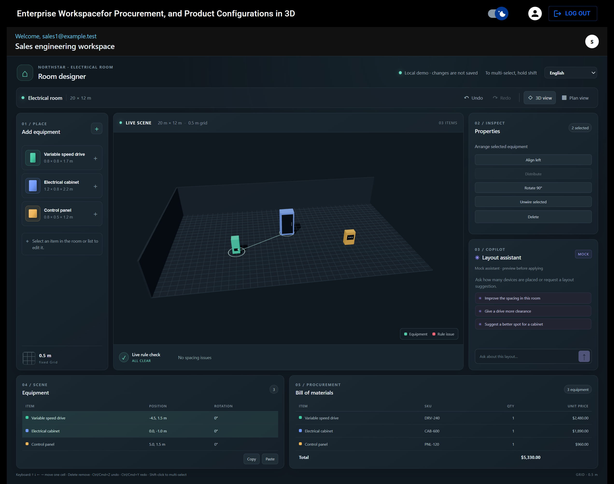
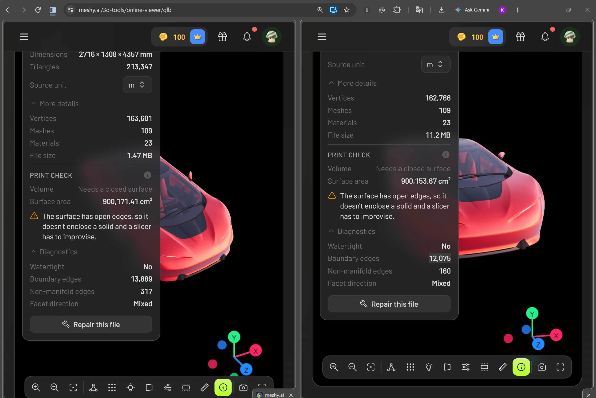

<hgroup>
    <h1 align="center">Enterprise Procurement Workspace and a Embedded 3D Configuration Workspace</h1>
</hgroup>

I have a constant 120 FPS when using the micro-app on my laptop. My laptop is Motobook 60 Pro which has an Intel Core Ultra 5 225H 16 Core CPU (1.70 GHz), 16 GB RAM, 512 GB SSD, Intel Arc 130T GPU (8GB) (128 MB), a monitor with 2.8 K resolution, and 120 FPS refresh rate.

When I added 500 objects to the scene, moving or rotating objects causes the frame rate to drop to around 10 to 30 FPS for around 5 -10 seconds. But moving the camera without moving or rotating any objects, maintained a constant 120 FPS.



### AI Usage

I used AI to create i18n translations, improve docs including README.md, spot hidden bugs, polish UI, generate seed data for testing, and to create the 3D editor micro-app.

I setup guardrails to enforce code quality and security standards using ESLint, Prettier, GitHub CodeQL Acrtion, test cases, AGENTS.md, etc...
I used git work-trees to allow multiple AI agents and myself to work parallelly in different branches of the same repository without conflicting with each other’s work.

Since the 3D viewer is more closely related to visual features, agents working on it spawned real browser instances and took screenshots to analyse the scenes. I monitored at these circumstances to ensure that the agents don’t use too much credits.

I limiting their workspaces to specific directories and files avoiding unwanted token consumptions. Whenever possible I provided relevant line numbers and file paths, relieving the agents from having to search through the codebase files.

I used agents to summarize huge manuals and API references.

## Follow the below steps to run the app locally

## 🖥️ System Requirements & Prerequisites

Before running the application, ensure you have the following prerequisites installed for your specific operating system:

### For Windows 11

- **Node.js & pnpm:** Install via the [Node.js official website](https://nodejs.org) or via terminal: `winget install OpenJS.NodeJS`. Then install pnpm globally: `npm i -g pnpm`.
- **Docker:** Download and install **Docker Desktop for Windows**. Ensure the WSL 2 backend option is enabled during setup.
- **Terminal:** Use **PowerShell**, **bash**, or **Windows Terminal** (avoid legacy Command Prompt).

### For macOS

- **Node.js & pnpm:** Install via [Homebrew](https://brew.sh): `brew install node && npm i -g pnpm`.
- **Docker:** Download and install **Docker Desktop for Mac** (make sure to select the correct installer for your Mac: Apple Silicon or Intel chip).
- **Terminal:** Use the native **Terminal app** or **iTerm2**.

---

## 🛠️ Setup and Run Locally

### 1. Clone this repository into your local machine

If you have git installed, create a folder for this repository on your local machine and run:

```shell
git clone https://github.com/sdev-buildz/procurement-3d.git .
```

If you don't have git installed, you can download the repository as a zip file from the [GitHub repository](https://github.com/sdev-buildz/procurement-3d). Unzip the file and open the folder in your preferred text editor.

For the next steps, make sure you are in the root folder of the repository.

### 2. Install Dependencies

Open your terminal application from the root of the repository folder and execute:

```shell
pnpm i
```

### 3. Start Database Using Docker

In the folder ./packages/db, add and configure a .env file using ./packages/.env.example as reference.

The database container requires Docker running in the background.

- **Windows 11:** Launch **Docker Desktop** from your Start Menu and wait for the dashboard engine indicator to turn green.
- **macOS:** Launch **Docker** from your Applications folder (or via Spotlight: `Cmd + Space` -> "Docker") and wait for the whale icon in the top menu bar to stop animating.

Once Docker is fully active, open a dedicated terminal window/tab and run:

```shell
docker compose up
```

_(Keep this terminal open to keep the database active.)_

### 4. Set up the database

In case the database that you configured in the **DATABASE_URL** environment variable in the ./packages/.env does not exist, you can create it using pgadmin. In pgadmin, add a new server and create the database.

Run this command to create the schema in the database.

```shell
pnpm run prisma:migrate-prod
```

Run this command to seed the database with sample data.

```shell
pnpm run prisma:seed
```

### 5. Start API Server for both the Surfaces

Open a **new** dedicated terminal window/tab and run:

```shell
pnpm run start-server
```

It runs at "https://localhost:443". You can configure the port by setting **API_SERVER_PORT** in ./packages/procurement/.env file.

_(Leave this terminal open to keep the backend server alive.)_

### 5. Start React Server for the Surface 1 and the host application

Open another **new** dedicated terminal window/tab to start the frontend application:

```shell
pnpm run start-react:watch
```

It runs at "https://localhost:3000". You can configure the port by setting **WEB_CLIENT_PORT** in ./packages/procurement/.env file.

_(Leave this terminal open. Your default browser should automatically open the app's local interface.)_

### 6. Start the micro-app server

Open another **new** dedicated terminal window/tab to start the micro=app:

```shell
pnpm run start-embed:watch
```

It runs at "https://localhost:3001". You can configure the port by setting **EMBED_CLIENT_PORT** in ./packages/embed/.env file.

_(Leave this terminal open. Your default browser should automatically open the app's local interface.)_

### 7. Open the website

Open the url "https://localhost:443" (use the port you set in ./packages/procurement/.env) in the browser. If it shows like "Your connection is not private", click Advanced => "Proceed to localhost (unsafe)" (or equivalent).

Open the url "https://localhost:3000" (use the port you set in ./packages/procurement/.env) in the same browser. If it shows like "Your connection is not private", click Advanced => "Proceed to localhost (unsafe)" (or equivalent).

### 8. Use the micro-app as a sales-engineer

Once the login page opens, use these credentials to login.

Username: sales1@example.test  
Password: oNW-h7W5PHIOF2LK--facbM7

Click `Browse 3D Layouts` button.

Now the micro-app should open automatically.

You can use the micro app to configure the 3D layout.

#### 9. Onboard as a supplier

Click `Logout` at top right corner of the screen. Once the login page opens, use these credentials to login.

Username: supplier2@example.test  
Password: oNW-h7W5PHIOF2LK--facbM7

The onboarding page should open automatically.

#### 9. Review and approve RFQ bids as a buyer

Click `Logout` at top right corner of the screen. Once the login page opens, use these credentials to login.

Username: buyer1@example.test  
Password: oNW-h7W5PHIOF2LK--facbM7

The onboarding page should open automatically.

## GLB Optimization

I took a 11.23 MB GLB file from [Khronos sample GQL files repo](https://github.khronos.org/glTF-Assets/model/CarConcept) and compressed it to 1.47 MB.

| Metric             | Before optimization | After optimization |
| ------------------ | ------------------: | -----------------: |
| Size               |            11.23 MB |            1.47 MB |
| Vertices           |             162,766 |            163,601 |
| Triangles          |             213,347 |            213,347 |
| Non-manifold edges |                 317 |                160 |
| Boundary edges     |              13,889 |             12,075 |


